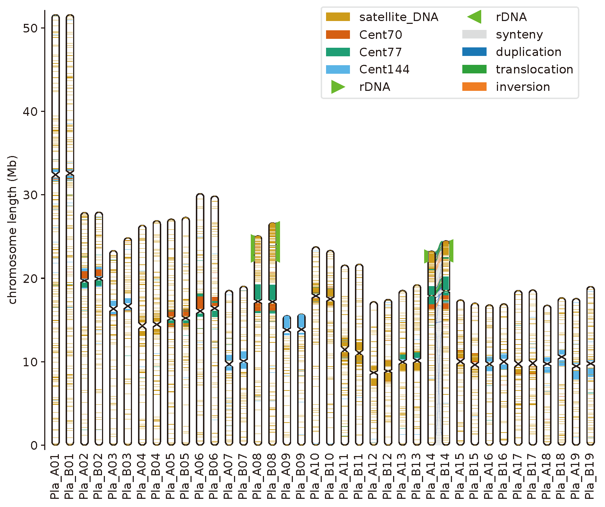
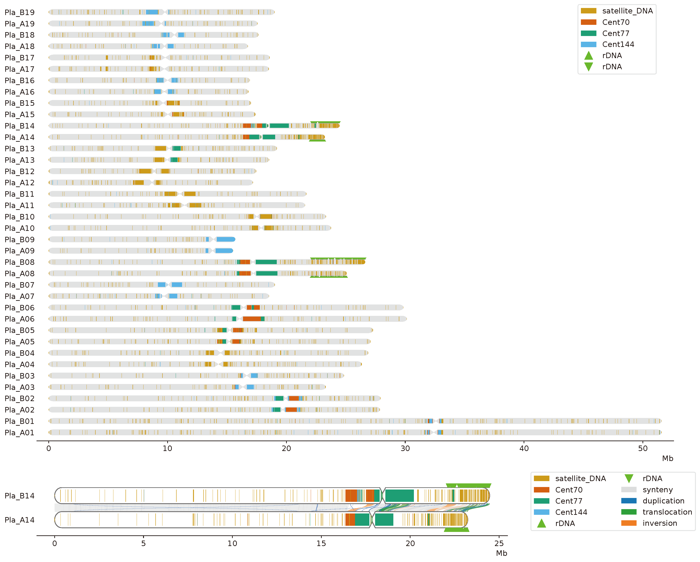

[](https://pypi.org/project/chromosome-ideogram)

# ChromosomeIdeogram
A python package for drawing genome-wide data on ideograms.

## Install
```shell
pip install chromosome-ideogram --upgrade
```

## Usage example
### Draw the vertical chromosome ideograms
```python
import matplotlib.pyplot as plt
from chromosome_ideogram import ChromosomeIdeogram

plt.rcParams['font.size'] = 12
plt.rcParams['pdf.fonttype'] = 42

fig = plt.figure(figsize=(10, 8))
axes = fig.add_subplot(111)

ci = ChromosomeIdeogram(
    karyotype='example/karyotype.xls',
    radius=0.4,  # Radius of chromosome
    space=4  # Chromosome center coordinate interval (radius x space)
)
ci.draw_chrom(axes=axes, centromere_angle=60, facecolor='white', edgecolor='black', linewidth=1.0)
ci.annotations(axes=axes, annotations='example/satellite_DNA.bed', height=None)

# show rDNA array
ci.mark_loci(axes=axes, markers='example/hapA_rDNA_left.bed', pos='left', size=0.4)  # Show rDNA on the left side of the haplotype A chromosome
ci.mark_loci(axes=axes, markers='example/hapB_rDNA_right.bed', pos='right', size=0.4)  # Show rDNA on the right side of the haplotype A chromosome

# show chromosome 14 synteny
ci.draw_synteny(axes=axes, synteny_file='example/Chr14_SV.bed')

axes.legend(handles=ci.handles, loc=(0.5, 0.8), ncol=2)

plt.savefig('example/vertical_chromosome.pdf', bbox_inches='tight')
plt.savefig('example/vertical_chromosome.png', bbox_inches='tight')
```


### Draw the horizontal chromosome ideograms
```python
import matplotlib.pyplot as plt
from matplotlib import gridspec
from chromosome_ideogram import ChromosomeIdeogram

plt.rcParams['font.size'] = 12
plt.rcParams['pdf.fonttype'] = 42

fig = plt.figure(figsize=(18, 15))
gs = gridspec.GridSpec(nrows=12, ncols=4)
axes1 = fig.add_subplot(gs[:10, :])
axes2 = fig.add_subplot(gs[10:, :3])  # Used to display the detailed karyotype of a certain chromosome (such as chromosome 14)

ci1 = ChromosomeIdeogram(
    karyotype='example/karyotype.xls',
    radius=0.4,  # Radius of chromosome
    space=4  # Chromosome center coordinate interval (radius x space)
)
ci1.draw_chromh(axes=axes1, centromere_angle=60, facecolor='lightgrey', edgecolor=None, linewidth=0)
ci1.annotations(axes=axes1, annotations='example/satellite_DNA.bed', height=None)
# show rDNA
ci1.mark_loci(axes=axes1, markers='example/hapA_rDNA_bottom.bed', pos='bottom', size=None)  # Draw the rDNA beneath haplotype A chromosomes
ci1.mark_loci(axes=axes1, markers='example/hapB_rDNA._topbed', pos='top', size=None)  # Draw the rDNA above haplotype B chromosomes

# Create a second karyotype ideogram object (containing only chromosome 14)
ci2 = ChromosomeIdeogram(
    karyotype='example/Chr14_karyotype.xls',
    radius=0.4,
    space=3
)
ci2.draw_chromh(axes=axes2, centromere_angle=60, facecolor='white', edgecolor='#4d4d4d', linewidth=1)
ci2.annotations(axes=axes2, annotations='example/satellite_DNA.bed', height=None)
ci2.mark_loci(axes=axes2, markers='example/hapA_rDNA_bottom.bed', pos='bottom', size=None)
ci2.mark_loci(axes=axes2, markers='example/hapB_rDNA._topbed', pos='top', size=None)
ci2.draw_synteny(axes=axes2, synteny_file='example/Chr14_SV.bed') # show synteny

axes1.legend(handles=ci1.handles, loc=(0.85, 0.85))  # Set axes1 legend
axes2.legend(handles=ci2.handles, loc=(1.05, 0.1), ncol=2)  # You can also set axes2 legend

plt.subplots_adjust(hspace=9)  # Adjust the vertical distance between the two subgraphs

plt.savefig('example/horizontal_chromosome.pdf', bbox_inches='tight')
plt.savefig('example/horizontal_chromosome.png', bbox_inches='tight')
```

